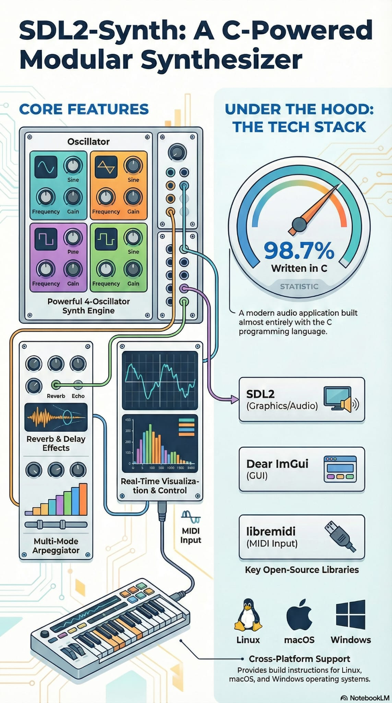

A modular synthesizer written in C, available as a standalone app (SDL2 for graphics and audio, MIDI input via libremidi) and as a **VST3 instrument plug-in** (Linux, Windows and macOS).



Live demo at: https://koppi.github.io/sdl2-synth


[](https://github.com/koppi/sdl2-synth/issues)
[](https://github.com/koppi/sdl2-synth/releases/latest)

## Features

- **4-oscillator synth**: Each with independent waveform, pitch, detune, gain, phase, pulse width, and unison controls
- **Mixer**: Control the mix and master volume of each oscillator with bus compression
- **Effects**: Flanger, delay, reverb, and analog filter with real-time controls
- **Arpeggiator**: Multiple modes, adjustable tempo, octave control, and multi-octave chord arpeggiation
- **Oscilloscope & Spectrum**: Visualize output waveform and frequency spectrum
- **MIDI input**: Map MIDI CC to synth parameters for external control
- **Interactive Keyboard**: On-screen piano keyboard with visual feedback
- **VST3 plug-in**: The same engine and user interface inside your DAW, with host automation, state saving, MIDI input and tempo sync (see below)

## Build Dependencies

CMake downloads and builds these automatically:

- SDL2 (graphics, audio, events) - standalone app
- Dear ImGui (GUI library)
- libremidi (MIDI input) - standalone app
- Steinberg VST 3 SDK (MIT licensed) - VST3 plug-in only

You need CMake 3.15 or newer (3.25 for the plug-in), a C and C++ compiler, and on Linux the usual
development packages for X11, OpenGL and ALSA.

## Build Instructions

### Linux

```sh
sudo apt-get install git cmake build-essential libx11-dev libxext-dev libxcursor-dev libxi-dev \
    libxrandr-dev libxss-dev libxfixes-dev libxkbcommon-dev libgl1-mesa-dev libasound2-dev \
    libpulse-dev libudev-dev
git clone https://github.com/koppi/sdl2-synth && cd sdl2-synth
cmake --preset release
cmake --build --preset release && build/release/synth
```

### macOS

```sh
brew install git cmake
# Then build as above
```

### Windows

Install CMake and Visual Studio 2022 (C++ workload), then from a developer prompt:

```sh
cmake --preset release-windows
cmake --build --preset release-windows
```

### VST3 plug-in

```sh
cmake --preset vst3                    # Windows: vst3-windows, macOS: vst3-macos-universal
cmake --build --preset vst3
ctest --test-dir build/vst3 -C Release # smoke test: audio, automation, state
```

The plug-in bundle is written to `build/vst3/VST3/Release/sdl2-synth.vst3`; copy it to your VST3
folder (`~/.vst3`, `~/Library/Audio/Plug-Ins/VST3` or `C:\Program Files\Common Files\VST3`).
The build also runs Steinberg's VST3 validator on the plug-in. Pass `-DSYNTH_BUILD_STANDALONE=OFF`
to build only the plug-in.

## Running

```sh
build/release/synth
```

## MIDI Control

MIDI input is mapped to numerous parameters (see `src/midi.c` for mapping). All GUI controls respond to mouse drag and mouse wheel. The oscilloscope is fed directly from the audio callback thread for real-time visualization.

## VST3 plug-in

Download a ready-made plug-in for your platform from the
[releases page](https://github.com/koppi/sdl2-synth/releases/latest) and follow the `INSTALL.txt` inside.
It shows up as an instrument called **SDL2 Synth**.

- **Parameters**: every knob in the editor (about 115) is an automatable host parameter, grouped by section.
- **MIDI**: notes (sample accurate), pitch bend (+/-2 semitones) and these controllers, which the host
  maps to parameters: CC1 LFO 1 depth, CC7 master volume, CC10 master pan, CC71 filter resonance,
  CC72/73/75 envelope release/attack/decay, CC74 filter cutoff, CC91 reverb mix, CC93 flanger depth,
  CC94 delay mix.
- **Tempo**: the arpeggiator and the multi-tap delay follow the host tempo while *Host Sync* is on.
- **State**: saved with the project; presets of the host work as usual.
- **Editor**: the same Dear ImGui interface as the standalone app, resizable. It is drawn by a small
  software renderer, so it needs neither OpenGL nor extra libraries and behaves the same on every OS.
  On Linux the host has to provide the VST3 `IRunLoop`, as all Linux hosts do.
- Not in the plug-in: the standalone app's computer-keyboard input, MIDI Learn (use your host's
  mapping instead) and the chord progression generator.

### Releases

Pushing a version tag builds the plug-in for all platforms, validates it and publishes a GitHub release:

```sh
git tag v1.2.3 && git push origin v1.2.3
```

macOS packages are ad-hoc signed. To ship them signed and notarized with an Apple Developer ID, add the
repository secrets `APPLE_CERTIFICATE_P12` (base64), `APPLE_CERTIFICATE_PASSWORD`, `APPLE_SIGNING_IDENTITY`,
`APPLE_ID`, `APPLE_TEAM_ID` and `APPLE_APP_PASSWORD`; the workflow then signs and notarizes automatically.

VST is a registered trademark of Steinberg Media Technologies GmbH. See `THIRD-PARTY-NOTICES.md` for the
licenses of the bundled components.
